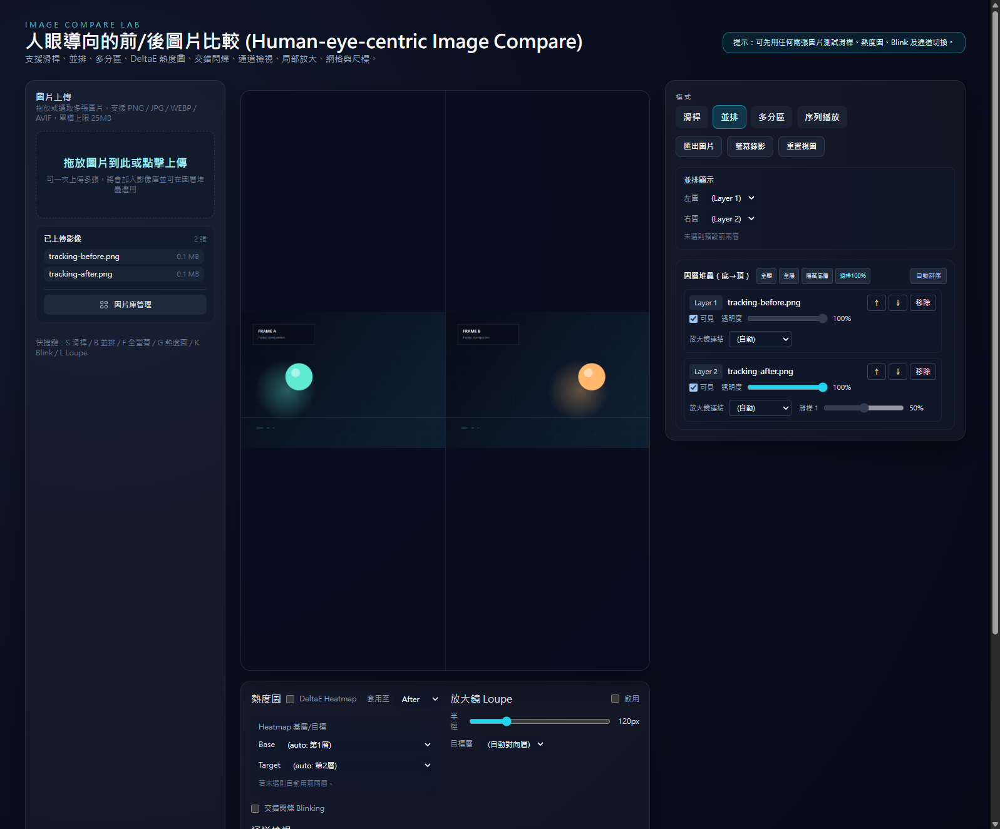
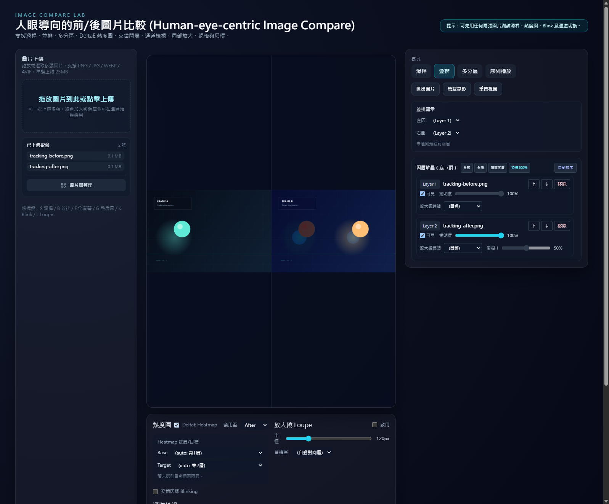

# Image Compare Lab (ImageShow)

A browser workbench for human-eye-oriented before/after image comparison. Import multiple images, stack them as layers, and compare with a slider, side-by-side view, multi-split view, or sequence playback — plus DeltaE heatmaps, blink comparison, channel isolation, edge emphasis, gamma preview, grid/rulers, and a linked magnifier.

**Live demo:** <https://fcyd5454.github.io/image-comparison-app/>

The demo runs in local-only mode: images stay in memory and are never uploaded. The full app includes an Express upload API for server-side storage.

## Screenshots

<p align="center">
  
</p>

<p align="center">
  
</p>

<p align="center"><sub>Sample images generated for the demo.</sub></p>

## Features

- Comparison modes: **slider**, **side-by-side**, **multi-split** (2–4), and **sequence playback** with crossfade.
- Layer stack supporting up to 500 images, with visibility/opacity controls, linked groups, auto-arrange, and hide-base-layer tools.
- **DeltaE heatmap** computed in a Web Worker, with threshold/opacity controls and mean/max statistics.
- **Blink comparison** with adjustable rate and automatic group cycling.
- Channel view (RGB / R / G / B / Luma), edge emphasis, gamma and brightness preview, grid and rulers.
- Linked magnifier and synchronized viewports; zoom, pan, and reset.
- Image library with drag-and-drop upload; 25 MB per file; PNG/JPEG/WebP/AVIF.
- Export the current comparison as a PNG.
- Session state persisted in localStorage (server-hosted images only).

## Repository layout

```text
frontend/  React + TypeScript + Vite UI
server/    Express 5 upload API (multer)
```

## Requirements

- Node.js 20.19 or newer (Vite 7)
- npm

## Run locally

Start the upload API:

```bash
cd server
npm install
npm run dev
```

The API listens on <http://localhost:4000> (health check: `/api/health`).

Start the frontend in a second terminal:

```bash
cd frontend
npm install
npm run dev
```

Open <http://localhost:5173>. The frontend calls `VITE_API_BASE` (default `http://localhost:4000`). To point it at another API:

```bash
VITE_API_BASE=http://localhost:4000 npm run dev
```

## Production build

```bash
cd frontend
npm run build

cd ../server
npm run build
npm start
```

Serve `frontend/dist` with any static host. If the app is served from a subpath, set `BASE_PATH` at build time:

```bash
BASE_PATH=/image-comparison-app/ npm run build
```

## Local-only demo build

```bash
VITE_LOCAL_ONLY=true BASE_PATH=/image-comparison-app/ npm run build
```

In this mode the upload API is bypassed and images remain in memory as blob URLs. Refreshing the page clears them. The hosted GitHub Pages demo uses this mode.

## Notes and limitations

- Accepted upload types: PNG, JPEG, WebP, AVIF; maximum 25 MB per file.
- `server/uploads` stores uploaded files. There is no authentication or automatic cleanup, so do not expose the API publicly without adding access control and storage management.
- The DeltaE heatmap runs in a Web Worker; very large images may take a moment to process.

## License

[MIT](LICENSE)
